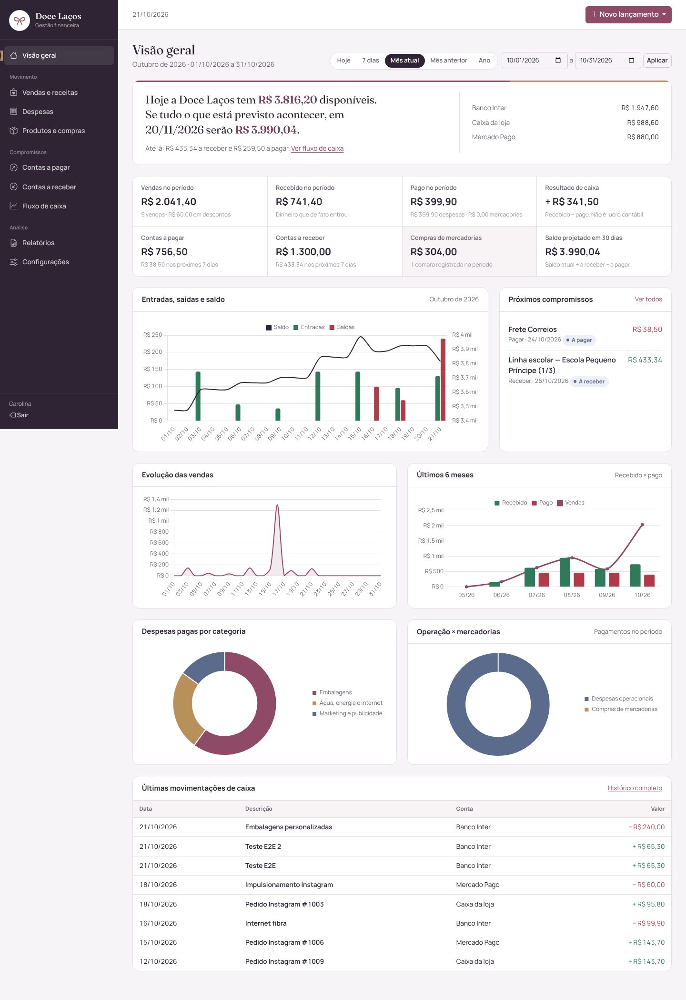

# Doce Laços — Sistema de Gestão Financeira

Aplicação web para controlar encomendas, vendas, receitas, despesas, compras de mercadorias, contas a pagar e a receber, fluxo de caixa e relatórios da Doce Laços. Vários usuários com login próprio, acessível pelo navegador, com banco PostgreSQL.

## O que a aplicação faz

| Área | O que tem |
|---|---|
| Encomendas | Quadro Kanban (arrastar entre etapas) e tabela, número DL-0001, itens com personalização e desconto, prazo com horário, retirada/entrega, sinal e pagamentos parciais integrados ao financeiro, pendências, alertas de atraso, histórico completo (detalhes em `docs/ENCOMENDAS.md`) |
| Usuários | Logins individuais, ativação/desativação, redefinição de senha, último acesso; autoria em todos os registros e histórico de alterações com antes/depois |
| Visão geral | Saldo atual (frase de destaque), projeção, 8 indicadores por período (hoje, 7 dias, mês, mês anterior, ano, personalizado), 5 gráficos, próximos compromissos e últimas movimentações |
| Vendas e receitas | Venda com itens ou valor total, desconto, à vista ou a prazo, parcelamento, recebimento parcial, cancelamento com estorno; outras receitas (reembolso, aporte etc.) |
| Despesas | Categoria, fornecedor, competência × vencimento × pagamento, parcelamento, recorrência mensal |
| Produtos e compras | Cadastro de produtos com custo e preço sugerido, compras de mercadorias separadas das despesas operacionais, histórico de custo por produto |
| Contas a pagar / receber | Filtros, vencidas, a vencer, liquidação total ou parcial direto da lista, histórico, estorno |
| Fluxo de caixa | Por dia, semana ou mês; realizado × previsto; saldo projetado; saldo por conta |
| Relatórios | 11 relatórios com filtros, links para os lançamentos e exportação CSV e Excel |
| Configurações | Nome, logotipo e cores da marca, contas financeiras e saldos iniciais, categorias, formas de pagamento, usuários, troca de senha, cópia de segurança, conferência dos cálculos, registro de alterações |

## Tecnologias

Python 3.13 · Flask 3.1 · SQLAlchemy 2.1 · Flask-Migrate (Alembic) · PostgreSQL 16 · Flask-Login · Flask-WTF (CSRF) · Bootstrap 5.3 · Chart.js 4 · Gunicorn · openpyxl. Bootstrap, Chart.js, ícones e fontes ficam dentro do projeto (sem CDN), o que permite uma política de segurança de conteúdo (CSP) sem scripts externos.

## Estrutura

```
app/
  __init__.py          fábrica da aplicação, cabeçalhos de segurança, erros
  config.py            configurações por ambiente (dev, testes, produção)
  models.py            modelo de dados (títulos, liquidações, vendas, compras…)
  auth.py              login, logout, limitação de tentativas
  cli.py               comandos: setup, create-user, reset-password, backup-json, restore-json, check
  utils.py             dinheiro (Decimal), datas e períodos no padrão brasileiro
  services/
    finance.py         regras que alteram dados financeiros (transacionais)
    metrics.py         indicadores, saldos, fluxo de caixa, conferência
    reports.py         relatórios e exportação CSV/Excel
    backup.py          cópia completa e restauração em JSON
  views/               telas (uma por módulo)
  templates/           HTML (Jinja2)
migrations/            migrações do banco
public/static/         CSS, JS, fontes e bibliotecas (servidos pela CDN no Vercel)
tests/                 testes automatizados (PostgreSQL)
scripts/               build do Vercel, backup e restauração com pg_dump + GPG
docs/                  regras financeiras, backup, hospedagem
```

## Rodar localmente

Requisitos: Python 3.12+ e PostgreSQL 14+.

```bash
python -m venv .venv && source .venv/bin/activate      # Windows: .venv\Scripts\activate
pip install -r requirements-dev.txt
createdb docelacos
cp .env.example .env                                   # ajuste DATABASE_URL se precisar
export APP_ENV=development DATABASE_URL=postgresql://postgres@localhost:5432/docelacos
flask --app wsgi db upgrade        # cria as tabelas
flask --app wsgi setup             # categorias e formas de pagamento padrão
flask --app wsgi create-user       # pede usuário e senha (mín. 10 caracteres, maiúsculas, minúsculas e número)
flask --app wsgi run               # http://localhost:5000
```

## Testes

```bash
createdb docelacos_test && createdb docelacos_restore
TEST_DATABASE_URL=postgresql+psycopg://postgres@localhost:5432/docelacos_test pytest -q
```

Resultado da última execução: **64 testes aprovados**. Eles cobrem os 16 critérios de aceite do projeto (venda à vista, venda futura, recebimento parcial, despesa paga e pendente, pagamento parcial, compra a prazo, estorno e cancelamento, transferência, fluxo realizado e projetado, comparação de períodos, exportação, persistência, rota protegida, backup e restauração, ausência de duplicidade) e também CSRF, bloqueio de login, hash de senha, cabeçalhos de segurança e upload de logotipo.

Além disso, o comando abaixo confere, a qualquer momento, se os saldos batem lançamento a lançamento:

```bash
flask --app wsgi check
```

## Publicar na internet

**Vercel + Neon (atual):** veja [`docs/VERCEL.md`](docs/VERCEL.md).

### Alternativa: Render

Resumo do que **você** precisa fazer; nada disso foi feito por mim, porque envolve criar conta e contratar serviço.

1. Crie uma conta em https://render.com e conecte sua conta do GitHub.
2. No painel: **New → Blueprint**, escolha o repositório `doce-lacos-financeiro`. O Render lê o `render.yaml` e propõe dois recursos: o web service e o PostgreSQL. Confira os planos e a região antes de confirmar (veja `docs/HOSPEDAGEM.md`).
3. Aguarde o primeiro deploy. As migrações e a configuração inicial rodam automaticamente antes de cada deploy (`preDeployCommand`).
4. Crie o seu usuário: no serviço web, abra **Shell** e rode `flask --app wsgi create-user`.
5. Acesse a URL `https://doce-lacos-financeiro.onrender.com` (ou a que o Render indicar) e entre.
6. Primeira configuração dentro do sistema: **Configurações → Contas financeiras** (cadastre as contas com o saldo de hoje) e **Empresa e identidade** (envie o logotipo e as cores oficiais).
7. Domínio próprio (opcional): em **Settings → Custom Domains** do serviço, adicione `financeiro.seudominio.com.br` e crie o registro CNAME indicado no seu provedor de domínio. O certificado HTTPS é emitido pelo Render.

`SECRET_KEY` é gerada pelo próprio Render e `DATABASE_URL` é ligada ao banco automaticamente. Nenhum segredo fica no repositório.

**Atualizar:** cada `git push` na branch `main` gera um novo deploy (migrações incluídas).

**Esqueceu a senha:** outro usuário ativo redefine em Configurações → Usuários; se não houver, Shell do serviço → `flask --app wsgi reset-password`. A troca encerra as sessões abertas daquela pessoa.

**Novos usuários:** Configurações → Usuários (pede a senha de quem está logado). Os comandos `create-user` e `ensure-user` só criam o *primeiro* usuário.

Alternativas de hospedagem e custos estão em [`docs/HOSPEDAGEM.md`](docs/HOSPEDAGEM.md).

## Backup e restauração

Três camadas, detalhadas em [`docs/BACKUP.md`](docs/BACKUP.md):

1. Backups automáticos do PostgreSQL feitos pela hospedagem (precisam ser conferidos no painel do provedor).
2. `scripts/backup_pg.sh`: dump completo do banco criptografado com GPG, para guardar fora da hospedagem.
3. Cópia completa em JSON pela tela **Configurações → Backup** (pede a senha) ou `flask backup-json`, restaurável com `flask restore-json`.

Exportar CSV/Excel de relatórios **não** é backup: serve para análise.

## Regras financeiras

Resumo; a versão completa está em [`docs/REGRAS_FINANCEIRAS.md`](docs/REGRAS_FINANCEIRAS.md).

- Venda, despesa, receita e compra geram **títulos** (a receber ou a pagar). Só a **liquidação** move dinheiro.
- Saldo atual = saldos iniciais + entradas efetivadas − saídas efetivadas ± transferências.
- Resultado de caixa = recebido − pago no período. **Não é lucro contábil.**
- Estorno é um lançamento inverso ligado ao original; nada é apagado e nada pode ser estornado duas vezes.
- Cada formulário leva um token único: enviar duas vezes não duplica o lançamento.
- Valores em `NUMERIC(14,2)` no banco e `Decimal` no Python; nunca ponto flutuante.

## Segurança

Senha com hash scrypt · CSRF em todos os formulários · bloqueio após tentativas de login (por IP e por usuário) · cookies `Secure`, `HttpOnly`, `SameSite=Lax` · sessão expira em 12 h e é invalidada ao trocar a senha · CSP sem scripts externos ou inline · HSTS e redirecionamento para HTTPS em produção · `no-store` em páginas com dados financeiros · consultas parametrizadas (SQLAlchemy) · escape automático de HTML (Jinja2) · logotipo SVG com conteúdo ativo é recusado · a aplicação não sobe em produção sem `SECRET_KEY` forte.

## Limitações conhecidas desta versão

- Não calcula lucro contábil nem custo das mercadorias vendidas (CMV): o controle de estoque é só de compras e custos.
- Sem emissão fiscal nem integração com maquininhas, bancos ou Nuvemshop.
- Recuperação de senha pelo terminal da hospedagem (não há envio de e-mail).
- Todos os usuários ativos têm o mesmo acesso (sem perfis).
- Cancelar encomenda com valores recebidos exige reembolso; reter sinal como multa ainda não é suportado.
- Alertas de encomendas só dentro da aplicação (sem WhatsApp/e-mail).
- A identidade visual é provisória até o envio do logotipo e das cores oficiais (trocáveis pela tela de Configurações, sem mexer no código).

## Telas

Capturas feitas com **dados de teste** no ambiente local (não são números reais da Doce Laços).


